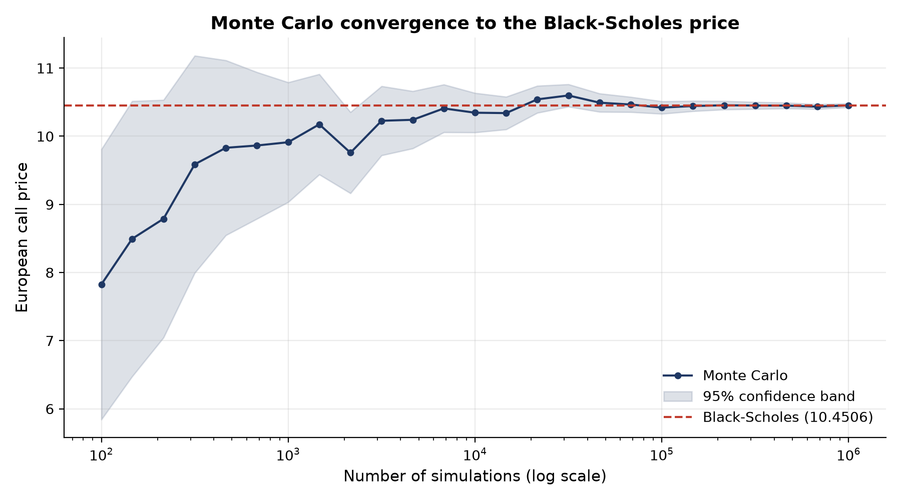
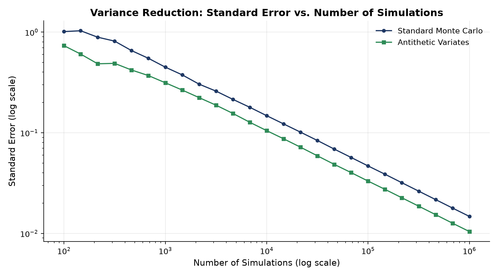
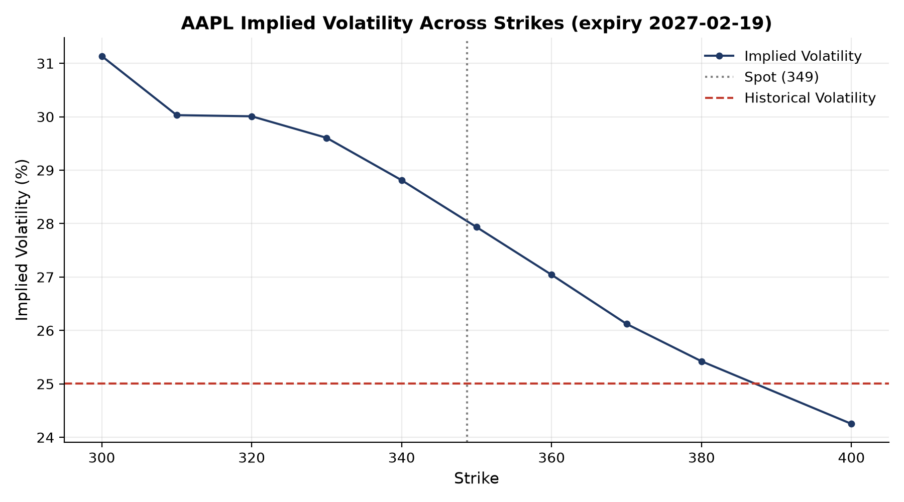

# European Option Pricing: Black-Scholes and Monte Carlo

Python implementation of European call and put pricing, validated against analytical identities and a Monte Carlo simulation.

## What this project does

- Prices European calls and puts with the **Black-Scholes formula**
- Verifies correctness with a **put-call parity** check
- Prices the call by **Monte Carlo simulation** under risk-neutral dynamics
- Quantifies simulation error with a **95% confidence band** and shows convergence to the analytical price
- Reduces simulation variance with **antithetic variates** and quantifies the gain
- Backs out **implied volatility** from market option prices with root-finding
- Plots the **volatility smile/skew** across strikes for a real AAPL option chain

## Method

**Black-Scholes**

$$d_1 = \frac{\ln(S/K) + (r + \sigma^2/2)T}{\sigma\sqrt{T}}, \qquad d_2 = d_1 - \sigma\sqrt{T}$$

$$C = S\,N(d_1) - K e^{-rT} N(d_2), \qquad P = K e^{-rT} N(-d_2) - S\,N(-d_1)$$

**Monte Carlo**

Terminal price under the risk-neutral measure:

$$S_T = S \exp\left(\left(r - \tfrac{\sigma^2}{2}\right)T + \sigma\sqrt{T}\,Z\right), \qquad Z \sim N(0,1)$$

The call price is the discounted average payoff $e^{-rT}\,\mathbb{E}[\max(S_T - K, 0)]$, and the standard error is $s/\sqrt{n}$.

**Antithetic variates**

For each draw $Z$, the mirrored path with $-Z$ is also simulated. Because the call payoff is monotonic in $Z$, the two payoffs are negatively correlated, so averaging each pair reduces variance. With the same number of payoff evaluations, the variance is scaled by $(1+\rho)$, where $\rho$ is the correlation between the payoffs of $Z$ and $-Z$. The standard error is computed on the pair averages, since the two paths in a pair are not independent.

**Implied volatility**

Given an observed market price, the implied volatility is the $\sigma$ for which the Black-Scholes price equals that market price. Because the option price is strictly increasing in $\sigma$, the root is unique and is found with Brent's method (`scipy.optimize.brentq`).

## Results

Test case: $S=100,\ K=100,\ T=1,\ r=0.05,\ \sigma=0.2$

| Method | Call price | Standard error |
|---|---|---|
| Black-Scholes | 10.4506 | n/a |
| Monte Carlo (100,000 paths) | 10.4205 | 0.0468 |
| Antithetic MC (100,000 paths) | 10.4673 | 0.0331 |

- Black-Scholes put: 5.5735
- Put-call parity $C - P = S - Ke^{-rT}$ holds to numerical precision
- At the same computational cost, antithetic variates reduce the standard error by about 29% (0.0468 to 0.0331), which corresponds to an estimated payoff correlation of about -0.5.



The Monte Carlo estimate converges to the analytical price. The error shrinks proportionally to $1/\sqrt{n}$: 100x more simulations give a 10x smaller standard error. A fixed random seed is used for reproducibility.



## Real market data example

Black-Scholes applied to listed AAPL call options (data via yfinance, 9 Nov 2026, approx. 15:50 CET; quotes are delayed and change continuously).

| Input | Value |
|---|---|
| Spot | 348.70 |
| Strike | 340 |
| Expiry | 2027-02-19 (T = 0.277 years) |
| Risk-free rate | 4.00% (assumption) |
| Option price (bid/ask mid) | 27.50 |

| Volatility | Value |
|---|---|
| Historical (1y, annualized) | 24.94% |
| Implied (from market price) | 28.81% |

### Implied volatility across strikes



Implied volatility for all call strikes within +/-15% of spot for one expiry. Mid prices from bid/ask are used; quotes with a relative spread above 10% are excluded, and the last traded price is used where no quote is available.

Implied volatility is **not flat** across strikes, which contradicts the constant-volatility assumption of Black-Scholes. It decreases with strike, the typical equity skew: the market pays more for protection against price drops and prices heavier left tails than a normal distribution implies.

## Limitations

- Black-Scholes assumes constant volatility, no dividends and European exercise. AAPL options are American style and AAPL pays a small dividend.
- The risk-free rate is an assumption, not an interpolated market curve.
- Quotes from yfinance can be delayed or stale, and wide bid/ask spreads make the mid price (and the implied volatility) uncertain.
- Option quotes from yfinance are delayed. Spot and option prices must come from the same time; stale quotes or spot prices distort the implied volatility level.
- Where bid/ask are missing, the last traded price is used, which can be stale for illiquid strikes.

## How to run

```bash
git clone https://github.com/rachellliz/Option-pricing-python.git
cd Option-pricing-python
python -m venv .venv
source .venv/bin/activate
pip install -r requirements.txt
jupyter notebook option_pricing.ipynb
```

## Possible extensions

- Path-dependent options (Asian, barrier)
- Greeks (delta, vega) and hedging simulation
- Fitting a volatility surface across expiries
